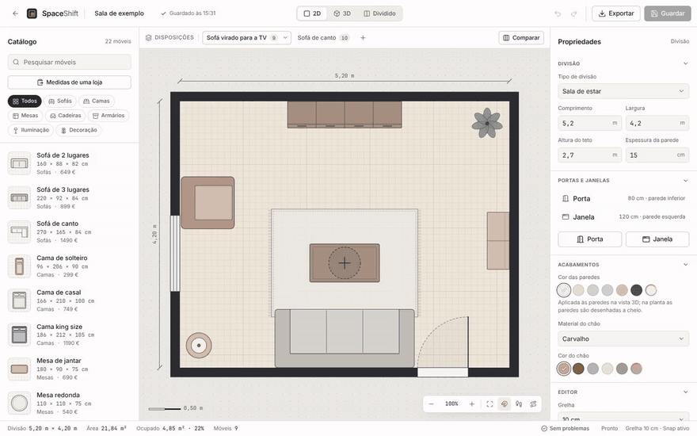
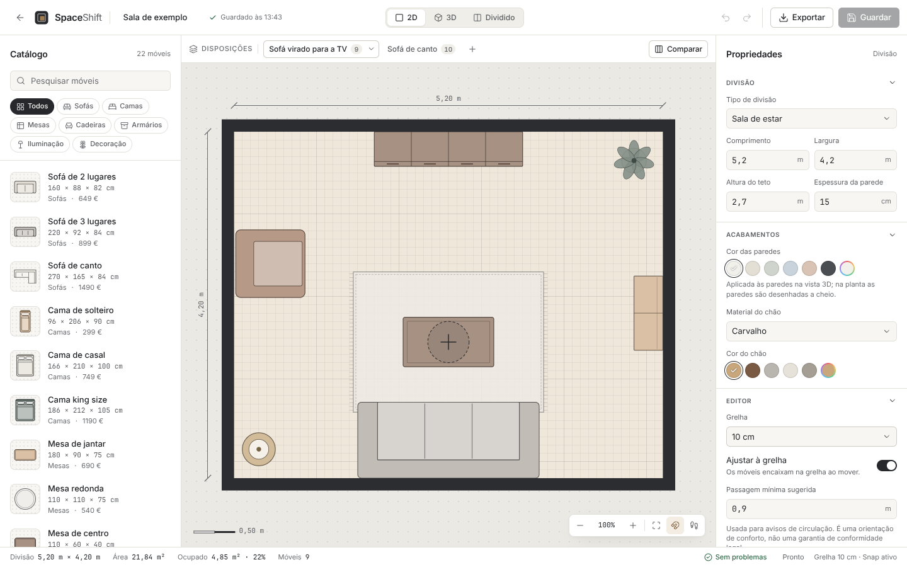
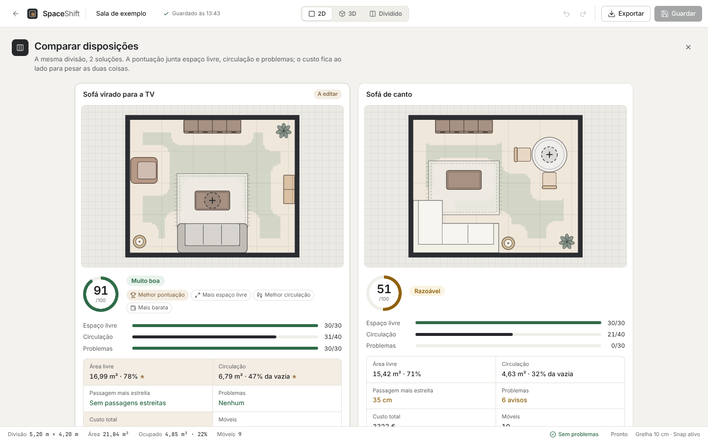
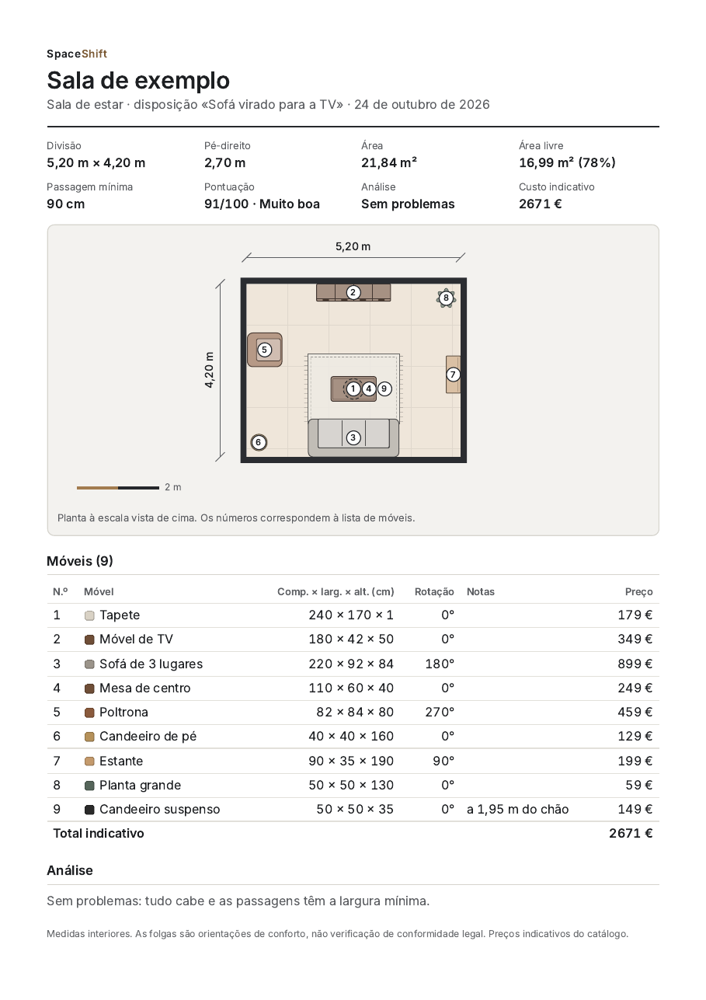
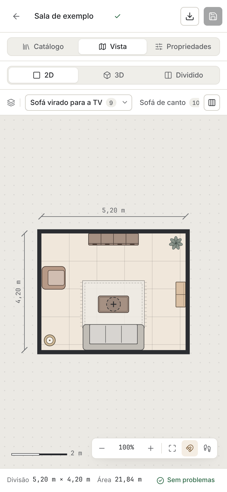

# SpaceShift

**Será que cabe? E consegue-se passar?** O SpaceShift é um estúdio de
interiores no browser para responder a estas duas perguntas antes de
comprar um móvel: desenha-se a divisão à escala, colocam-se os móveis
com as medidas reais e a aplicação mostra, em 2D e em 3D, o que não
cabe, o que se sobrepõe e por onde já não se consegue andar.



**Experimentar:** <https://estherchaves.github.io/spaceshift-app/> (funciona no computador, tablet e telemóvel, e pode ser instalado como app)

## O que faz

- **Planta 2D à escala** (SVG): arrastar, rodar e redimensionar móveis,
  com encaixe na grelha, cotas e zoom (roda do rato, trackpad ou dois dedos).
- **Vista 3D sincronizada** (React Three Fiber): a mesma disposição em
  3D, com modelos procedimentais, vistas rápidas da câmara e corte
  automático das paredes. Modo dividido com as duas vistas lado a lado.
- **Análise da disposição**: móveis fora da divisão, sobreposições,
  objetos mais altos do que o teto, passagens mais estreitas do que o
  mínimo escolhido e espaço de uso em falta (abrir o roupeiro, puxar a
  cadeira). A circulação livre é desenhada por cima da planta.
- **Portas e janelas** nas paredes, em 2D e 3D, com a área de abertura da
  porta contada nas colisões e as janelas tapadas assinaladas.
- **«Passa pela porta?»**: diz se um móvel chega à divisão pela porta do
  prédio, escada com patamar e corredor com curva (direito, deitado, ao
  alto ou inclinado) e quantos centímetros sobram ou faltam em cada passo.
- **Percurso a pé** entre dois pontos, com o comprimento e a passagem mais
  estreita marcada na planta.
- **Modo de acessibilidade** (cadeira de rodas ou carrinho de bebé):
  passagens mais largas e um círculo livre para rodar.
- **Medidas de uma loja**: colar o texto de um produto («L 220 x P 95 x A
  85 cm») cria o móvel com essas medidas.
- **Várias disposições por projeto** e **comparação lado a lado** com uma
  pontuação transparente (espaço livre, circulação, problemas) e o custo
  indicativo.
- **Projetos guardados no browser** com gravação automática, anular e
  refazer (um passo por gesto) e importação/exportação em JSON.
- **Exportação**: planta em PNG com cotas e lista de móveis, vista 3D em
  PNG e uma **ficha para imprimir ou guardar em PDF** (A4, com os móveis
  numerados na planta).
- **Instalável e sem internet** (PWA): «Instalar app» abre o SpaceShift em
  janela própria, e depois da primeira visita tudo funciona offline,
  incluindo a vista 3D. Uma versão nova só entra quando se aceita.
- **Acessível e responsivo**: navegação por teclado (setas movem o móvel
  selecionado, R roda, Delete apaga), contraste AA verificado com axe em
  computador, tablet e telemóvel, respeito por «reduzir movimento» e
  interface própria para ecrãs pequenos.

| Editor | Comparar disposições | Ficha para imprimir | Telemóvel |
| --- | --- | --- | --- |
|  |  |  |  |

## Tecnologia

React 19 e JavaScript (sem TypeScript), Vite, Zustand, Three.js com
React Three Fiber e drei, lucide-react, Vitest com Testing Library e
Oxlint. Sem servidor: os projetos ficam no `localStorage`, atrás de um
repositório assíncrono que pode ser trocado por uma API.

Algumas decisões que vale a pena ver no código:

- **Núcleo sem React** (`src/core`): modelo, geometria (polígonos
  rodados, distâncias), análise de colisões e circulação (grelha com
  transformada de distância) e histórico. É tudo funções puras e testadas.
- **Um documento, duas vistas**: a planta e a cena 3D leem o mesmo
  estado. Durante um arrasto só muda uma pré-visualização, e o documento
  é alterado uma vez, ao largar (é isso que dá um passo de anular por gesto).
- **Carregamento por partes**: o editor, a vista 3D e a exportação de
  imagens são módulos à parte, por isso a lista de projetos abre depressa.

Mais detalhe em [docs/ARCHITECTURE.md](docs/ARCHITECTURE.md).

## Correr localmente

Requer Node.js 20.19+ (testado com Node 22) e npm 10+.

```bash
npm install        # instalar dependências
npm run dev        # servidor de desenvolvimento (http://localhost:5173)
npm run test       # testes (Vitest)
npm run lint       # Oxlint (avisos fazem falhar)
npm run build      # build de produção em dist/
npm run preview    # servir o build
npm run check      # lint + testes + build
```

Publicar: cada push na `main` corre o lint, os testes e o build e publica
no GitHub Pages (`.github/workflows/deploy.yml`). O caminho da app vem de
`BASE_PATH`; sem ele a app fica na raiz, como no Vercel.

Na primeira abertura, «Abrir projeto de exemplo» cria uma sala com duas
disposições para experimentar a comparação.

## Atalhos

| Tecla | Ação |
| --- | --- |
| Setas (Shift = passo maior) | Mover o móvel selecionado |
| R / Shift+R | Rodar |
| Ctrl+D | Duplicar |
| L | Bloquear ou desbloquear |
| Delete | Apagar |
| Ctrl+Z / Ctrl+Shift+Z | Anular / refazer |
| Ctrl+S | Gravar já |
| Ctrl+P | Imprimir a ficha do projeto |
| P | Percurso a pé (Esc sai) |
| Espaço + arrastar | Deslocar a planta |

## Estado

Fases 1 a 9 concluídas (fundações, planta, catálogo, edição, 3D, análise,
projetos, qualidade e, na Fase 9, portas e janelas, «passa pela porta?»,
percurso a pé, acessibilidade e medidas de uma loja), e PWA instalável
que funciona sem internet. A seguir: partilhar
uma disposição por link (precisa de um servidor).
